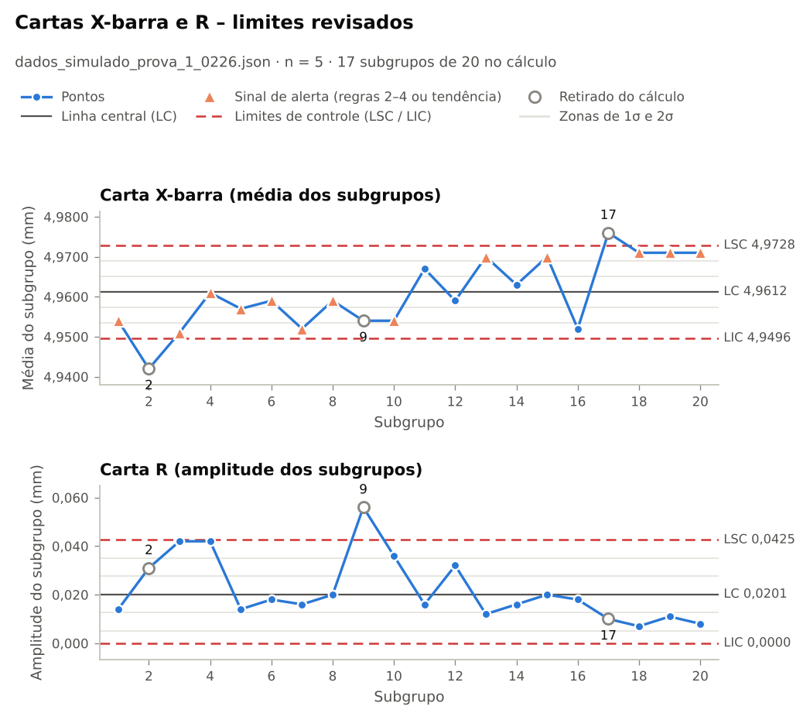
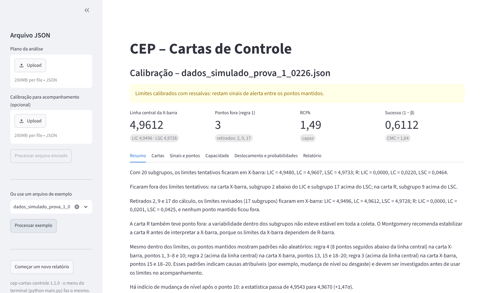
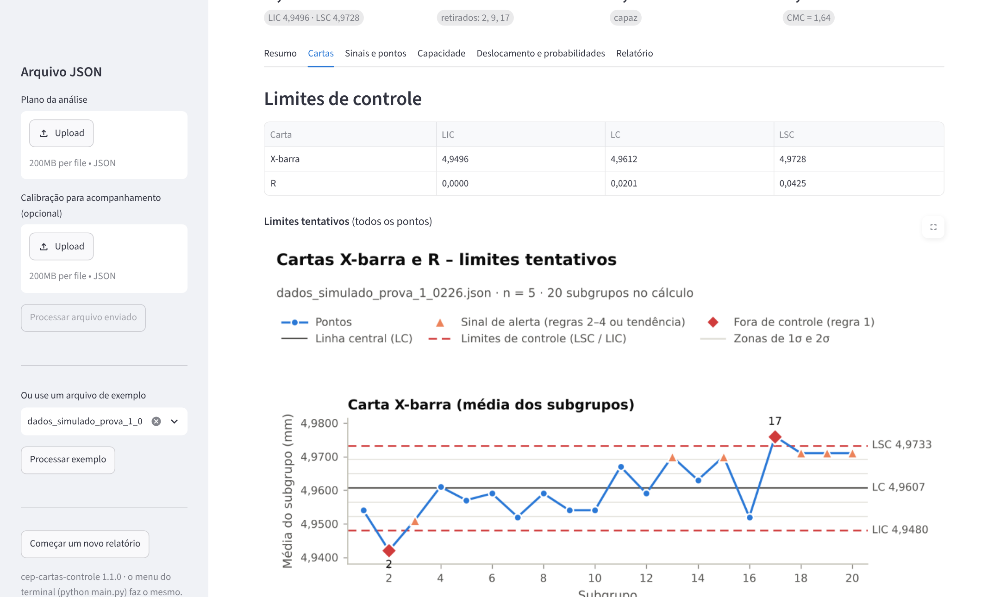
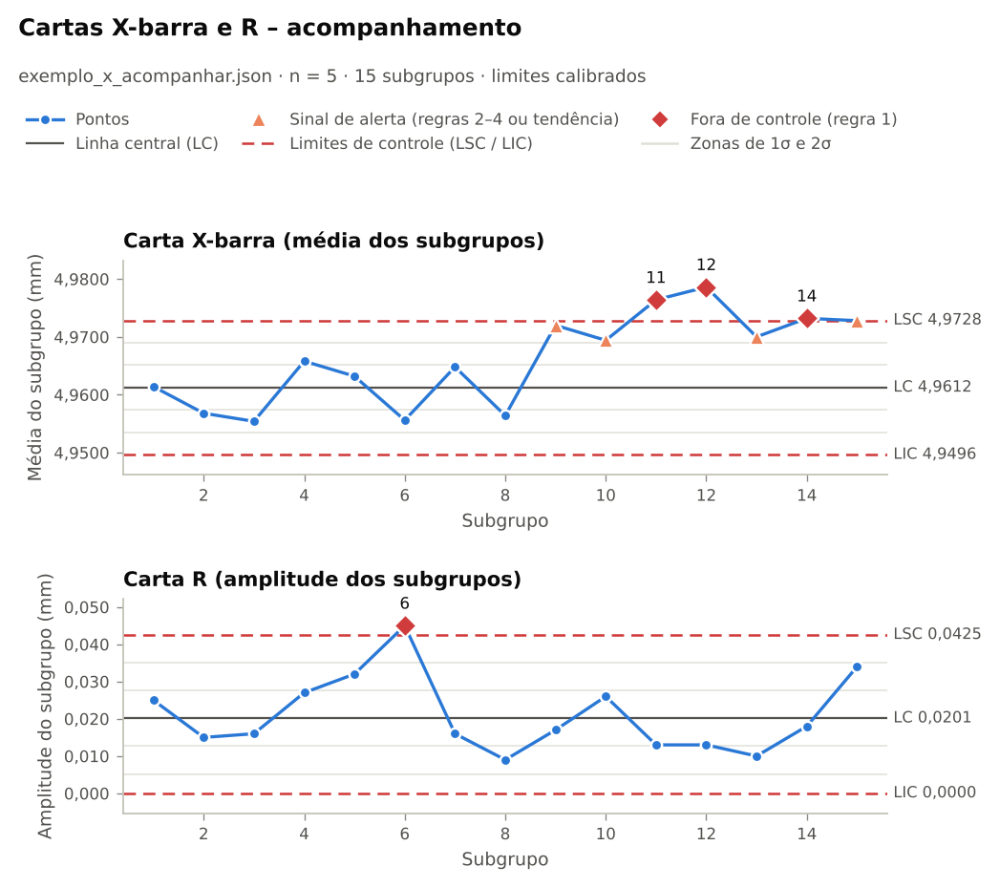
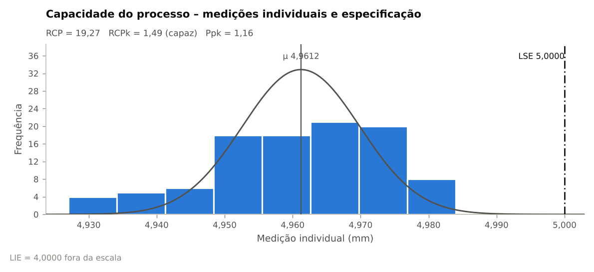

# CEP – Cartas de Controle

[](https://github.com/felipecduque7/cep-cartas-controle/actions/workflows/testes.yml)


Software em Python para **Controle Estatístico de Processos (CEP)**. Ele lê um plano de análise em
JSON, calcula os limites das cartas de controle, aponta sinais de alerta, estima deslocamentos e a
chance de a carta detectá-los, avalia a capacidade do processo e gera um relatório PDF com tudo o
que foi feito.

Projeto da disciplina **Controle Estatístico Remoto de Processos** (Engenharia Eletrônica –
FGA/UnB, 2º/2026). Referência: Montgomery & Runger, *Estatística Aplicada e Probabilidade para
Engenheiros* (LTC).



## Destaques

- **7 cartas de controle:** X-barra e R, R, I-AM, p, np, c e u, com fórmulas e fatores do livro.
- **Calibração (Fase I) e acompanhamento (Fase II):** limites tentativos e revisados, com retirada
  dos pontos fora de controle; o acompanhamento reaproveita a calibração salva.
- **Sinais de alerta:** regras Western Electric e tendência, com os pontos de cada sinal.
- **Deslocamento e probabilidades:** mudança de nível (com correção de Bonferroni), tendência,
  β, probabilidade de detecção e CMC, calculados pela distribuição exata de cada carta
  (normal, binomial, Poisson ou amplitude).
- **Capacidade:** RCP, RCPk, Pp, Ppk e fração estimada fora da especificação.
- **Relatório PDF cumulativo** com interpretação em texto, tabelas e gráficos.
- **Três formas de uso:** menu no terminal, linha de comando e uma página web opcional (Streamlit).
- **Módulo de entrada:** medições por teclado, arquivo CSV ou porta serial (Arduino/ESP32).
- **122 testes automatizados**, incluindo o gabarito conferido à mão e 60 conjuntos de dados
  aleatórios, rodando no GitHub Actions em Linux e Windows.

## Em 1 minuto

```bash
python -m pip install -r requirements.txt
python main.py                                        # menu interativo
python main.py dados/dados_simulado_prova_1_0226.json # ou direto pela linha de comando
```

Resultado para o simulado da disciplina (20 subgrupos de 5 medições):

| | Resultado |
|---|---|
| Limites revisados da X-barra | LIC 4,9496 · LC 4,9612 · LSC 4,9728 mm |
| Subgrupos retirados na calibração | 2, 9 e 17 |
| Mudança de nível | +1,47σ depois do subgrupo 10 |
| Probabilidade de detectar esse deslocamento | 0,61 por amostra (CMC = 1,64) |
| Capacidade | RCPk = 1,49 · Ppk = 1,16 |

O relatório completo gerado pelo programa está em [`docs/relatorio_exemplo.pdf`](docs/relatorio_exemplo.pdf).

## Interface web





| Acompanhamento com os limites calibrados | Capacidade do processo |
|---|---|
|  |  |

## Arquitetura

```text
main.py / menu.py / app.py   interfaces (terminal, linha de comando, web)
          │
processamento.py             sessão: lê, analisa, salva, desenha e registra
          │
leitura → cartas → analise   motor de cálculo, independente das interfaces
regras · deslocamento · capacidade · probabilidade · calibracoes · constantes
          │
graficos · apresentacao · relatorio   saída: PNG, textos e PDF
```

O motor de cálculo não importa o menu nem o PDF. Por isso a mesma análise roda no terminal, na
página web e nos testes, e pode virar um serviço HTTP nos próximos projetos da disciplina.

## English summary

Python tool for **Statistical Process Control**. It reads a JSON plan, runs Phase I calibration and
Phase II monitoring for X-bar/R, I-MR, p, np, c and u charts, applies the Western Electric rules,
estimates level shifts and trends, computes detection probability and ARL from each chart's exact
distribution, reports process capability (Cp, Cpk, Pp, Ppk) and builds a cumulative PDF report.
It ships with a terminal menu, a CLI, an optional Streamlit web app, serial-port data acquisition
(Arduino/ESP32) and 122 automated tests. Course project, Electronic Engineering, University of
Brasília.

---

# Documentação

## 1. Instalação

Requisito: Python 3.9 ou mais recente.

```bash
python -m pip install -r requirements.txt
```

Use `python -m pip`, e não só `pip`: assim os pacotes vão para o mesmo Python que roda o
programa. No Windows é comum ter mais de um Python instalado (por exemplo, o da Microsoft Store
e o do python.org), e o `pip` sozinho pode instalar em outro. Se faltar algum pacote, o próprio
programa mostra o comando exato para o Python em uso.

## 2. Como usar

### Menu interativo

```bash
python main.py
```

```
  1) Processar arquivo JSON (calibração ou acompanhamento, conforme o arquivo)
  2) Registrar medições (módulo de entrada) e gerar JSON
  3) Calculadora de probabilidades (binomial, arranjos, tentativas, Poisson, desempenho)
  4) Deslocamentos possíveis da última análise (probabilidade de detecção e CMC)
  5) Guia: qual carta de controle escolher?
  6) Ver calibrações salvas
  7) Abrir o relatório PDF
  8) Começar um novo relatório
  9) Continuar o último relatório (depois de fechar o programa)
  0) Sair
```

Na opção 1 o programa lista primeiro os JSON baixados nos últimos 7 dias (pasta `Downloads`
do usuário), do mais recente para o mais antigo, e depois os das pastas `dados/`, `exemplos/` e
`entradas/`. No dia da prova, basta baixar o arquivo, abrir o programa e escolher o número 1.
Também dá para colar o caminho do arquivo ou arrastá-lo para o terminal. Depois de cada
atividade, o programa volta ao menu.

### Direto pela linha de comando

```bash
python main.py dados/dados_simulado_prova_1_0226.json
python main.py dados/*.json --abrir          # processa vários e abre o PDF no fim
python main.py acompanhamento.json --calibracao saida/calibracoes/calibracao_X_....json
python main.py novo.json --continuar         # acrescenta ao último relatório em vez de começar outro
```

Quando há arquivos de calibração e de acompanhamento juntos, as calibrações são processadas
primeiro, para que os acompanhamentos já encontrem os limites.

### Interface web (opcional)

A mesma análise também roda numa página no navegador, com abas (resumo, cartas, sinais, capacidade,
deslocamento e relatório), envio do JSON e download do PDF e da calibração:

```bash
python -m pip install -r requirements-web.txt
python -m streamlit run app.py
```

A página usa o mesmo motor de cálculo e gera o mesmo relatório que o menu. O menu do terminal continua
sendo a forma principal de uso e não depende do Streamlit.

### O que é gerado

```
saida/
├── calibracoes/                       limites calibrados (JSON), reaproveitados no acompanhamento
└── relatorio_AAAA-MM-DD_HHhMMmSSs/    uma pasta por sessão
    ├── relatorio.pdf                  relatório com TUDO o que foi feito na sessão
    ├── registro.json                  registro das atividades (de onde o PDF é gerado)
    └── graficos/                      cartas, capacidade e curva de detecção (PNG)
```

O PDF é refeito a cada atividade, sempre com todas as atividades anteriores da sessão. Ao abrir o
programa de novo começa um relatório novo; para continuar o anterior, use a opção 9 do menu ou
`--continuar`. Se o
PDF estiver aberto em um leitor que bloqueia o arquivo (comum no Windows), o programa salva uma
cópia com outro nome e avisa.

## 3. Formato do JSON

Formato usado em sala:

```json
{
  "Unit": "mm",
  "Measured_at": "2026-10-09 12:00:00",
  "Created_by": "Henrique",
  "Type": "X",
  "Goal": "Calibrar",
  "LSE": 5.0,
  "LIE": 4.0,
  "Data": [[4.96, 4.946, 4.95, 4.956, 4.958], [4.958, 4.927, 4.935, 4.94, 4.95]]
}
```

| Campo | Significado | Valores aceitos |
|---|---|---|
| `Type` | tipo da carta | `X` (X-barra e R), `R`, `IMR` (ou `I`, `MR`), `P`, `NP`, `C`, `U` |
| `Goal` | objetivo | `Calibrar` ou `Acompanhar` (também "calibração", "acompanhamento", "monitorar"...) |
| `Data` | medições | lista de amostras (veja abaixo) |
| `LSE`, `LIE` | limites de especificação | números (opcionais) |
| `Unit`, `Measured_at`, `Created_by` | metadados | texto (opcionais) |
| `Label` | descrição do processo | texto (opcional; se faltar, usa o nome do arquivo) |

A leitura não depende de maiúsculas, acentos ou idioma dos nomes dos campos (`Tipo`,
`Objetivo`, `Dados` também funcionam) e aceita números com vírgula decimal em texto
(`"4,95"`). Tudo o que o programa ajustar aparece como aviso no terminal e no relatório. Se algo
não puder ser lido, a mensagem diz exatamente onde está o problema (por exemplo,
`Data, amostra 2, valor 2: 'abc' não é um número`).

### Dados de cada tipo de carta

| Carta | Cada elemento de `Data` | Observações |
|---|---|---|
| X, R | `[x1, x2, ..., xn]` (um subgrupo) | subgrupos de tamanho diferente são aceitos; subgrupos de 1 valor passam para I-AM |
| IMR, I, MR | `[x]` ou `x` | listas com mais de um valor são lidas em sequência |
| P, NP | `[defeituosos, n]` | também `[0, 1, 0, ...]` (itens bons/defeituosos), ou só `defeituosos` com o campo `"n"` |
| C | `[defeitos]` | listas com vários valores são somadas (defeitos da unidade de inspeção) |
| U | `[defeitos, unidades]` | também só `defeitos` com o campo `"n"` (unidades) |

> Os formatos de P, NP, C e U ainda não foram confirmados com arquivos do professor; o programa
> aceita as variações acima para cobrir as possibilidades.

### Acompanhamento: de onde vêm os limites

Para um arquivo com `"Goal": "Acompanhar"`, o programa procura os limites nesta ordem:

1. calibração indicada com `--calibracao` (linha de comando) ou escolhida no menu;
2. limites escritos no próprio JSON, em qualquer destas formas:
   - `"LSC": 4.97, "LC": 4.96, "LIC": 4.95` (carta principal);
   - `"LSC": {"X": 4.97, "R": 0.0425}, "LIC": {"X": 4.95, "R": 0}, "LC": {"X": 4.96}` (por tipo de limite);
   - `"Limites": {"X": {"LSC": ..., "LC": ...}, "R": {...}}` (por carta);
3. arquivo de calibração citado no JSON (`"Arquivo_calibracao": "..."`);
4. calibrações feitas na sessão ou salvas em `saida/calibracoes/`, priorizando mesma unidade,
   mesmo tipo de carta e nível compatível com os dados.

Se a calibração mais próxima tiver outra unidade ou uma linha central muito distante dos dados
(mais de 6σ), o programa não a usa automaticamente, porque provavelmente é de outro processo.

## 4. O que o programa calcula

### Escolha da carta
O tipo vem do JSON. O programa valida se os dados combinam com a carta e explica a escolha no
relatório. A opção 5 do menu ajuda a decidir a carta a partir de perguntas sobre o processo.

### Calibração (Fase I)
1. Calcula os limites tentativos com todos os pontos.
2. Retira os pontos além dos limites (regra 1) e recalcula, até nenhum ponto restante ficar
   fora (limites revisados). Na X-barra e R, um subgrupo fora em qualquer das duas cartas sai do
   cálculo, porque R̄ entra nos limites da X-barra.
3. Aplica as regras de alerta aos pontos mantidos e registra as ressalvas: pelo Montgomery, um
   ponto só deve ser descartado depois de identificada a causa atribuível.
4. Salva a calibração em JSON para o acompanhamento.

Fórmulas (fatores A2, D3, D4 e d2 da tabela do livro, para n de 2 a 25):

| Carta | LC | LSC e LIC |
|---|---|---|
| X-barra | X̿ | X̿ ± A2·R̄ |
| R | R̄ | D4·R̄ e D3·R̄ |
| I | x̄ | x̄ ± 3·AM̄/1,128 |
| AM | AM̄ | 3,267·AM̄ e 0 |
| p | p̄ | p̄ ± 3·√(p̄(1 − p̄)/n) |
| np | n·p̄ | n·p̄ ± 3·√(n·p̄(1 − p̄)) |
| c | c̄ | c̄ ± 3·√c̄ |
| u | ū | ū ± 3·√(ū/n) |

### Sinais de alerta (regras Western Electric, Montgomery & Runger)
1. Um ponto além dos limites de 3σ.
2. Dois de três pontos consecutivos além de 2σ, do mesmo lado.
3. Quatro de cinco pontos consecutivos além de 1σ, do mesmo lado.
4. Oito pontos consecutivos do mesmo lado da linha central.

Mais o alerta de **tendência**: 6 pontos seguidos sempre subindo ou descendo. Na carta de
amplitude móvel só se aplica a regra 1, porque seus pontos são correlacionados (Montgomery &
Runger); na carta R, as regras 1 e 4.

### Deslocamento e tendência
- **Nível atual**: média dos últimos 5 pontos comparada à linha central, em σ do processo.
- **Mudança de nível**: a divisão da sequência em dois trechos que melhor separa os níveis,
  testada com o σ conhecido e correção de Bonferroni.
- **Tendência**: inclinação da reta de mínimos quadrados (teste t) e, se for significativa,
  quantos pontos faltariam para cruzar o limite de controle ou a especificação (extrapolação).
- **Avaliação fora do calibre**: quanto a média pode se deslocar antes de o RCPk chegar a 1
  (início da produção fora da especificação) e a chance de a carta detectar esse deslocamento.

### Probabilidades: sucesso, falha e tentativas
Para um deslocamento δ da média (carta X-barra com subgrupos de n):

- falha (não detectar em uma amostra): β = Φ(L − δ√n) − Φ(−L − δ√n);
- sucesso (detectar): 1 − β;
- tentativas até detectar: CMC = 1/(1 − β), e P(detectar em até m amostras) = 1 − β^m;
- alarme falso: α = 1 − β(0) ≈ 0,0027, CMC0 ≈ 370.

Nas cartas p e np, β vem da distribuição **binomial** (é aqui que entram combinações e arranjos);
nas cartas c e u, da Poisson; na carta R, da distribuição da amplitude relativa. O relatório traz
a tabela para deslocamentos possíveis (0,5σ, 1σ, 1,5σ...) e a curva de detecção.

### Capacidade
RCP = (LSE − LIE)/6σ e RCPk = min(LSE − μ, μ − LIE)/3σ, com σ estimado pela carta (R̄/d2 ou
AM̄/1,128). Critério: RCPk ≥ 1,33 capaz; 1,00 a 1,33 marginal; abaixo de 1,00 não capaz. O
programa também conta as medições fora da especificação e estima a fração fora (ppm).

Pp e Ppk são as mesmas contas com o desvio-padrão total s das medições (na calibração, só as dos
pontos mantidos). O σ da carta mede a variação dentro dos subgrupos; s inclui também as mudanças de
nível entre eles. Por isso o Ppk fica abaixo do RCPk quando o processo muda de nível: o RCPk mostra
o que o processo pode fazer, e o Ppk, o que ele fez de fato.

## 5. Módulo de entrada de medições

Opção 2 do menu. Pergunta o tipo de carta, o objetivo, a unidade, LSE/LIE e o responsável, e lê
as medições de uma destas fontes:

- **teclado**: um subgrupo por linha ou um valor por linha (aceita vírgula decimal);
- **arquivo CSV/TXT**: uma amostra por linha;
- **porta serial**: a placa (Arduino, ESP32...) envia um número por linha, por exemplo
  `Serial.println(leitura);`. Requer `pip install pyserial`.

O resultado é salvo em `entradas/` no mesmo formato JSON da sala e pode ser processado em
seguida.

## 6. Testes

```bash
python -m pip install pytest
python -m pytest
```

Os testes conferem, entre outras coisas:

- o gabarito do simulado: limites tentativos e revisados calculados à mão, e os subgrupos
  2, 9 e 17 retirados;
- a tabela de fatores contra o cálculo numérico;
- as probabilidades contra valores conhecidos do livro;
- as regras de alerta, uma a uma;
- dezenas de arquivos com formatos variados e dados aleatórios de todos os tipos;
- o menu, o módulo de entrada (inclusive uma placa serial simulada) e a linha de comando;
- a interface web, quando o Streamlit está instalado.

Para gerar de novo os exemplos simulados de todos os tipos: `python ferramentas/gerar_exemplos.py`.

## 7. Estrutura do projeto

```
cep-cartas-controle/
├── main.py                 ponto de entrada (menu ou linha de comando)
├── app.py                  interface web opcional (Streamlit)
├── cep/
│   ├── config.py           parâmetros (regras, separador decimal, pastas...)
│   ├── leitura.py          leitura e validação do JSON
│   ├── constantes.py       fatores A2, D3, D4, d2, d3 e distribuição da amplitude
│   ├── cartas.py           estatísticas e limites de cada carta
│   ├── regras.py           regras Western Electric e tendência
│   ├── analise.py          calibração (Fase I) e acompanhamento (Fase II)
│   ├── deslocamento.py     deslocamento, tendência, curva de detecção e CMC
│   ├── capacidade.py       RCP e RCPk
│   ├── probabilidade.py    binomial, arranjos, geométrica, Poisson, normal, t
│   ├── calibracoes.py      salvar e carregar calibrações
│   ├── graficos.py         figuras (matplotlib)
│   ├── relatorio.py        relatório PDF cumulativo (reportlab)
│   ├── apresentacao.py     textos de interpretação e resumo no terminal
│   ├── processamento.py    sessão: liga leitura, análise, gráficos e relatório
│   ├── entrada.py          módulo de entrada de medições
│   └── menu.py             menu interativo
├── dados/                  arquivos da disciplina (simulado da prova)
├── exemplos/               exemplos simulados de todos os tipos de carta
├── ferramentas/            gerador dos exemplos
├── tests/                  testes automatizados
└── .github/workflows/      testes automáticos no GitHub (Linux e Windows, Python 3.9 e 3.13)
```

O cálculo (`leitura`, `cartas`, `analise`, `deslocamento`...) não depende do menu nem do PDF.
Assim o mesmo motor pode ser usado depois em um servidor (projetos de CEP remoto da disciplina),
recebendo o JSON por HTTP e devolvendo os resultados.

## 8. Pontos a confirmar com o professor

- Formato dos dados nas cartas P, NP, C e U e dos arquivos de acompanhamento (os primeiros
  testes foram feitos só com a carta X).
- Seção 16.4 do Montgomery & Runger (4ª ed.): conforme a numeração, é a introdução aos gráficos
  de controle ou os gráficos para medidas individuais; os dois assuntos estão cobertos.
- Comprimento da corrida de tendência: o programa usa 6 pontos (o livro cita corridas de 8);
  basta mudar `TENDENCIA_SEQUENCIA` em `cep/config.py`.
- Controle por confiabilidade e por degradação e estimativa de parâmetros de f.d.p., que estão
  na ementa, não fazem parte desta versão.

## 9. Relato da equipe

O relato do que a equipe fez, decidiu e aprendeu está em
[`docs/RELATO_DA_EQUIPE.md`](docs/RELATO_DA_EQUIPE.md).

## 10. Licença

Distribuído sob a licença MIT. Veja [`LICENSE`](LICENSE).
